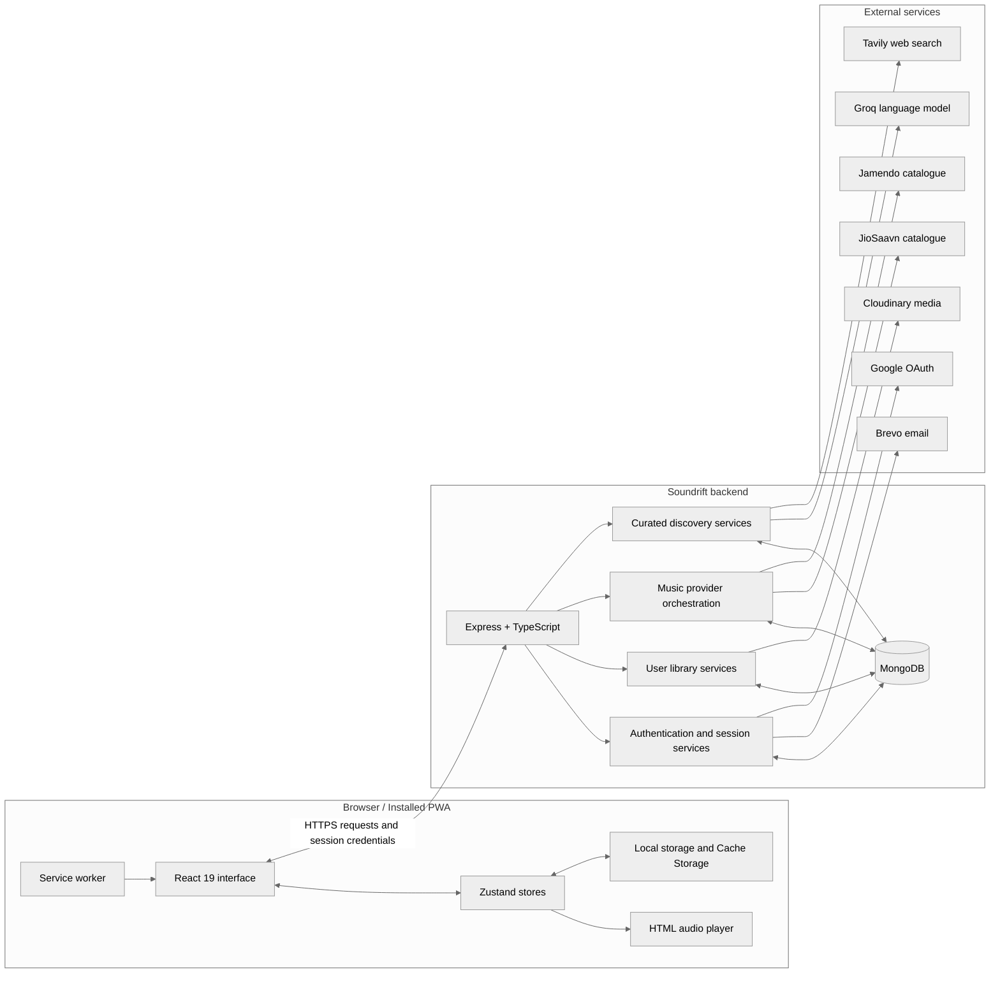
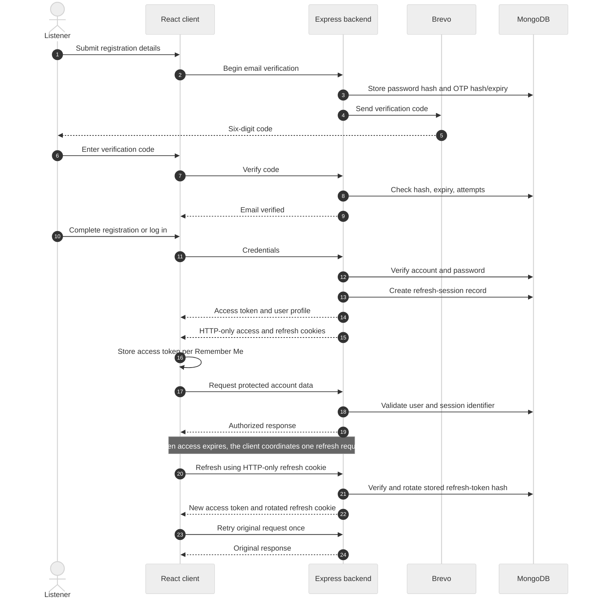
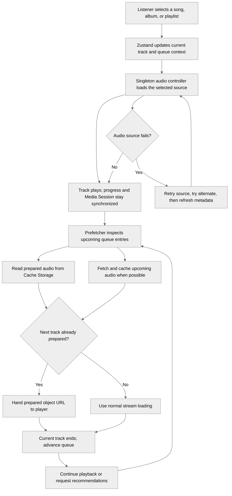
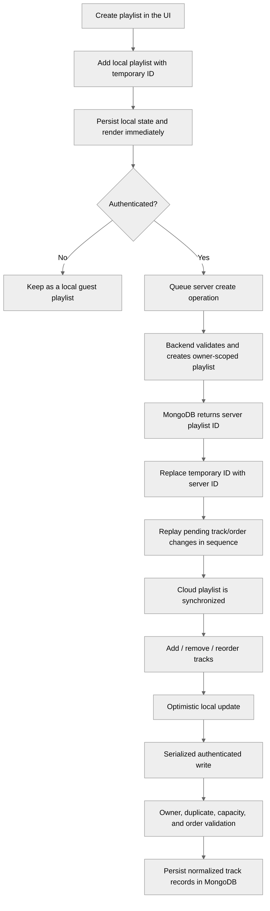
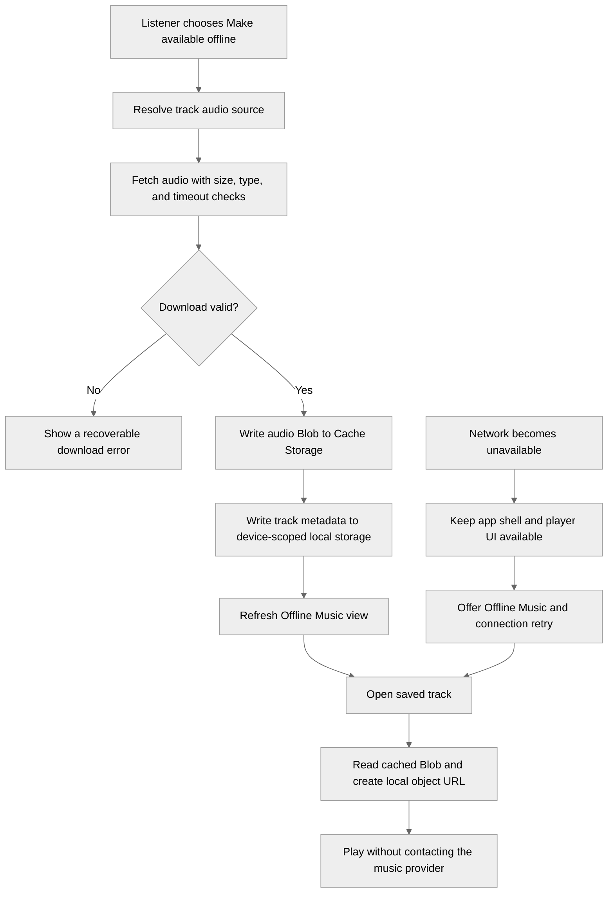
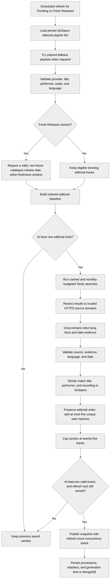

# Soundrift

> **Drift Into Your Next Favorite.**

[](https://www.soundrift.tech)
[](https://react.dev/)
[](https://www.typescriptlang.org/)
[](https://expressjs.com/)
[](https://www.mongodb.com/)
[](https://web.dev/progressive-web-apps/)

Soundrift is a full-stack music discovery and streaming application. It combines a responsive React player, a provider-agnostic music catalogue, account-backed listening libraries, local offline downloads, and a backend editorial discovery system. The application is designed to keep the listening experience responsive while treating authentication, external catalogue availability, and network interruptions as normal operating conditions.

**Live application:** [www.soundrift.tech](https://www.soundrift.tech)

---

## What Soundrift offers

### Music discovery

- Search songs and browse trending selections, genres, albums, artists, playlists, new releases, and editorial collections.
- Explore ten persistent curated sections, including Trending Now, Editor's Picks, Fresh Releases, K-Pop, Worldwide, Golden Era Hindi, 90s Bollywood, Monsoon Songs, After Midnight, and Morning Drive.
- Open catalogue entities through shareable application URLs.
- Discover related tracks using provider suggestions, artist and album relationships, ranking, and a trending fallback.
- Normalize results from multiple providers into one client-facing music model.

### Listening and playback

- A single page-lifetime HTML audio controller shared by the application.
- Queue management with play next, reordering, shuffle, and repeat modes.
- Seeking, volume, mute, playback progress, and buffering/error states.
- Browser and operating-system media controls through the Media Session API.
- Keyboard shortcuts and a Canvas-based audio visualizer.
- Stream recovery that retries the current source, tries an alternate source, and can request refreshed track metadata.
- Background preparation of upcoming tracks to reduce gaps between songs.

### Personal library

Signed-in listeners can synchronize their library across sessions:

- Favorites.
- User-created playlists, including track insertion, removal, and reordering.
- Recently played tracks and listening history.
- Search history.
- Profile details and avatar images.

Library changes are reflected locally first and synchronized with the backend when an account is available. Guest-created library data remains local to the browser until it is cleared or otherwise replaced; the cloud-backed personal library is tied to the authenticated account.

### Offline listening and PWA

- Save supported songs using **Make available offline**.
- Browse a dedicated Offline Music collection and play saved files without a network connection.
- Offline downloads are device-scoped, not account-scoped, so they remain available across sign-in and sign-out.
- Inspect saved-track count and storage usage, remove individual downloads, or clear the offline collection.
- Install Soundrift as a Progressive Web App and retain the application shell for a more resilient return experience.

### Curated discovery

Soundrift uses two complementary curation approaches:

- **AI-assisted sections:** Groq proposes song candidates for editorial themes. Soundrift resolves those candidates against the music catalogue, validates them, removes duplicates, and persists the resulting section.
- **Editorial and web-supported sections:** Trending and Fresh Releases begin with pinned JioSaavn editorial playlists. Budgeted web research can provide a small number of additional, cited discoveries after strict catalogue matching.

Curated sections are generated in the backend and stored in MongoDB. The frontend reads persisted snapshots rather than asking an AI model to generate a new playlist every time someone opens the page.

---

## System architecture

The frontend owns the interactive experience and local playback state. The backend owns account security, cloud library persistence, catalogue orchestration, and curated-section generation. External music and utility services are accessed from the backend so their credentials and provider-specific response formats do not leak into the browser.



### Responsibilities by layer

| Layer | Responsibility |
|---|---|
| React and Vite | Application shell, navigation, discovery surfaces, account screens, library views, and player controls. |
| Zustand | Shared authentication, player, queue, search, and library state. |
| Browser storage | Session preferences, locally responsive library state, playback restoration, offline metadata, and cached audio files. |
| Express API | Validates requests, applies security middleware, and delegates work to application services. |
| MongoDB and Mongoose | Account and refresh-session records, playlists, favorites, listening history, search history, curation snapshots, and curation locks/budgets. |
| Provider adapters | Hide catalogue-specific response formats and expose normalized music entities. |
| External integrations | Music catalogue data, AI-assisted candidate generation, web evidence, email delivery, avatar storage, and Google identity. |

A normal request moves from a page or shared client service through the backend's validation and security layers into a controller and service. The service either reads or updates MongoDB, consults a provider, or coordinates an external integration. The backend returns a normalized response; the frontend updates its shared state and renders the result.

---

## Authentication and session lifecycle

Soundrift supports email/password accounts, email verification, Google sign-in, password recovery, and renewable sessions. The frontend and backend share responsibility: the browser presents the current access credential, while the server decides whether the underlying account and session are still valid.

### Email registration

1. The listener submits their name, email, and password to begin registration.
2. The backend normalizes the email, hashes the password, generates a six-digit verification code, hashes that code, and stores its expiry and attempt counter.
3. Brevo delivers the code to the supplied email address.
4. The listener submits the code. The backend checks its hash and expiry and enforces the attempt limit.
5. Once verified, registration completes and the backend creates an authenticated session.
6. The frontend records the returned access token according to the Remember Me choice and initializes the signed-in library.

Verification codes expire after ten minutes. Resending is rate-limited by a cooldown, and verification attempts are bounded. A verified email is required before an email/password account can be registered.

### Login and Google sign-in

Email/password login checks the stored password hash and the account's active status. If the email has not yet been verified, the login flow directs the listener through email verification rather than issuing a normal session.

Google sign-in uses an authorization-code flow. Soundrift creates a short-lived, HTTP-only state cookie before redirecting to Google. On the callback, the backend checks the returned state against the stored value, validates the authorization code and Google identity, and then either links the verified identity to an existing account or creates a new account. A successful callback establishes the same Soundrift session model used by password login.

### Access and refresh tokens

Soundrift uses separate signing secrets for access and refresh tokens:

- **Access token:** short-lived credential used to authenticate normal application requests. The backend associates it with a user and a session identifier.
- **Refresh token:** longer-lived credential held in an HTTP-only cookie and used only to renew the session.
- **Remember Me:** determines whether the browser's access-token copy is kept in persistent local storage or session storage. The server also preserves the session's persistence policy in its refresh-session record.

The backend stores a SHA-256 hash of each refresh token in the user's session records rather than storing the raw token. Refresh rotates the token and updates its stored hash. A short grace period allows parallel browser tabs that submit the immediately previous token during a rotation race to recover without unnecessarily terminating the session. The middleware checks the JWT, its session identifier, session expiry, user existence, and active account status before attaching the user to a protected request.

The frontend request client coordinates concurrent refresh attempts through a shared in-flight refresh operation. When an access token expires, it attempts renewal and retries the original request once. A definitive unauthorized/forbidden refresh response ends the session. A temporary network failure or backend 5xx response is treated as an availability problem, not proof that the account session is invalid; the frontend keeps the session trace and retries the session check.

### Authentication flow



A listener can also log out explicitly. The backend revokes the refresh session when the refresh credential is available and clears the authentication cookies. The frontend removes its token, clears the signed-in account library from the active client state, and stops account playback state.

---

## Music discovery and playback

### Provider abstraction and fallback

The frontend does not need to understand the individual catalogue APIs. It requests Soundrift music entities from the backend, which delegates to provider adapters and returns a common model.

**JioSaavn is the primary catalogue** for search, track details, albums, artist albums, and editorial playlists. **Jamendo is the fallback** for compatible search and metadata lookups when the primary provider fails or does not return usable results. The fallback is not treated as interchangeable for every feature: artist catalogue and editorial playlist discovery depend on JioSaavn-specific capabilities.

Before results reach the client, the backend:

1. Normalizes provider-specific song, album, and playlist fields.
2. Decodes HTML entities and cleans display text.
3. Resolves performer credits, preferring credits marked as singers instead of assuming that the first primary credit is the performer.
4. Extracts appropriate artwork and available audio sources.
5. Filters irrelevant search noise, deduplicates candidates, and ranks useful matches.
6. Uses a shorter cache lifetime for degraded/fallback results so a temporary provider outage does not remain visible for as long as healthy primary results.

The client receives consistent track fields and a provider marker. It can therefore play, favorite, queue, cache, and persist a track without depending on the original provider response shape.

### Player lifecycle

A single HTML audio element is controlled for the lifetime of the page. Zustand stores the selected track, queue, current index, playback state, volume, shuffle order, repeat mode, and related UI state. The audio controller subscribes to relevant state changes and translates them into media-element operations.

Starting playback from an album or playlist passes the whole collection and selected index as the queue context. Starting a standalone song creates a one-track queue that can later be extended by recommendations. Queue entries have their own identity so the same catalogue track can appear more than once without confusing queue operations.

The player reports progress and buffering state to the store, updates Media Session metadata and position, and supports media-key actions where the browser provides them. When a stream fails, recovery is bounded: retry the current source, try an alternate available audio source, and finally request fresh track metadata and a new stream URL. Playback position is retained when a source is replaced, and a refreshed URL is copied to the matching queue entry for later replay.

### Queue preparation and recommendations

While a track plays, the prefetcher examines upcoming queue entries and prepares audio in the background. It keys cached audio by provider, track identity, and stream quality. Cache Storage holds downloaded audio bodies; response headers contain enough metadata to rebuild its in-memory index after a reload. The cache applies entry and byte limits, removes stale tracks, and evicts least-recently-used entries that are not needed for the current playback plan.

The next track can be turned into a ready object URL before the current track ends. This lets the player switch to an already prepared file without waiting for another network request at the handoff. If persistent browser caching is unavailable, the prefetcher limits its work and leaves ordinary streaming available.

Recommendations combine provider-native suggestions with same-artist and same-album candidates. Candidates are scored, deduplicated, and supplemented with trending tracks when the related catalogue does not return enough useful options.



---

## Playlists and the personal library

Soundrift's personal library is designed to respond immediately while still maintaining server ownership and persistence for signed-in accounts.

### Creating a playlist

1. The frontend creates a playlist in the local Zustand library and assigns it a temporary client identifier.
2. The change is saved locally so the interface can show the new playlist immediately.
3. When the listener is authenticated, a serialized background operation creates the cloud playlist.
4. The backend validates its name and description, attaches the authenticated user as owner, and stores the playlist in MongoDB with an initially empty track list and a private visibility default.
5. The server-generated playlist identifier replaces the temporary client identifier. Pending local edits are then replayed against the server playlist in order.

Guest playlists remain local. They can be exported and imported; an imported playlist can be synchronized after sign-in.

### Adding, removing, and reordering tracks

Tracks are normalized before being stored as playlist subdocuments. The saved record includes the provider identity, catalogue ID, title, artist, duration, album and artwork information, and available audio metadata. This keeps a playlist usable without requiring a fresh catalogue lookup for every screen render.

Playlist writes are serialized per playlist on the client so rapid actions preserve their intended order. On the backend, every operation is scoped to the authenticated owner. Adding a track uses an atomic database condition to prevent concurrent duplicate inserts and checks the track capacity. Reordering sends track IDs rather than entire track objects; the backend verifies that the requested order contains every existing track exactly once before saving it. Removal and updates also require the correct owner.

Current server-side limits are 200 playlists per account, 500 tracks per playlist, 100 characters for a playlist name, and 500 characters for a description. A duplicate add is idempotent: the existing playlist is returned rather than inserting the same provider track twice.

### Library synchronization

Favorites, playlists, recently played entries, listening history, and search history are stored against the authenticated user in MongoDB. The client keeps a responsive local copy and performs cloud writes as the listener makes changes. The frontend also protects against stale operations: a library synchronization or write that belongs to a previous sign-in generation must not overwrite a newer account's state.

On a confirmed session expiration, the frontend clears the signed-in account's library state and re-checks authentication. During temporary network failure, it preserves the local session and account data for a retry. Logging out clears account-specific library state from the current browser, but it does not erase the device-scoped offline downloads.



### Other library data

- **Favorites:** provider-aware track records are upserted per user and track identity.
- **Recently played:** stores the latest play timestamp per user and track, retaining a bounded recent list.
- **Listening history:** records playback duration, completion state, track metadata, and play time, with a bounded history.
- **Search history:** normalizes queries and keeps a short recent list.
- **Profile and avatar:** profile details are stored with the user account; avatar images are uploaded to Cloudinary, with replacement cleanup for the prior asset.
- **Account deletion:** removes the account's playlists, favorites, recent activity, listening history, and search history, and attempts to remove its Cloudinary avatar.

---

## Offline music and Progressive Web App

Offline downloads and automatic playback prefetching solve different problems:

- **Offline Music** is a user-controlled collection. The listener explicitly saves a song and can find it later in the Offline Music view.
- **Playback prefetching** is an automatic, temporary optimization for upcoming queue entries. Its cache is pruned as the queue and listening history change.

### Saving a song for offline listening

When the listener selects **Make available offline**, the browser downloads the selected audio source directly. The download uses a bounded timeout, checks that the response is a supported audio type, and enforces a per-track size limit. Audio bytes are written to Cache Storage; track metadata, saved time, and file size are recorded in local storage. The interface is notified when the offline library changes.

Offline records use a device owner rather than a user ID. This is intentional: a guest can download music, and the same downloads remain available if the listener signs in, signs out, or changes accounts on that browser. A migration routine also merges earlier account-keyed offline records into the device collection and moves their cached audio where possible.

Offline availability depends on the browser's storage support and the continued presence of its local site data. These files are not uploaded to the Soundrift account or synchronized between devices. The source provider must also permit the browser to fetch the audio resource cross-origin.

### Offline and prefetch lifecycle



The PWA layer provides installability, a service worker-managed application shell, connection-state notifications, and update notifications. It does not make every catalogue feature available offline: search, streaming, cloud library operations, and remote discovery still require connectivity. Saved offline tracks are the supported path for offline listening.

---

## Editorial discovery and AI-assisted curation

Curated sections are backend-generated snapshots. The scheduler checks whether each section is behind its latest scheduled slot, queues refreshes, and stores successful results in MongoDB. The frontend reads those snapshots and their generation metadata.

### Section strategies

**AI-assisted editorial sections** use Groq to produce structured song candidates from a section-specific prompt. The backend parses and deduplicates the candidates, searches the provider catalogue for each title/performer pair, checks the match score and artist similarity, requires usable audio, and removes duplicates. Candidate order is retained. Sections sharing an overlap group are compared so a song does not unnecessarily appear in multiple competing rows.

**Live editorial/web sections** power Trending and Fresh Releases. They start from pinned JioSaavn playlist IDs rather than searching for a playlist by a potentially ambiguous title. Configured fallback playlist IDs are tried when the preferred playlist is unavailable or insufficient. The editorial list is filtered before it can be used: records must be valid JioSaavn tracks, contain usable title/performer/audio information, and belong to Hindi, Punjabi, or Haryanvi discovery. Fresh Releases additionally requires a valid catalogue release date within the configured freshness window (30 days by default).

### Live editorial and web pipeline

Tavily research is attempted only when an editorial seed exists. Search calls are cached per day and query, restricted to approved HTTPS source domains, and reserved against a monthly MongoDB budget before each external attempt. Groq extracts candidates only from the returned source documents; it does not invent source URLs or substitute for evidence.

Each web candidate must have evidence for its song title, performer, and date, and its source must pass the allowlist. Soundrift then looks for the exact recording in JioSaavn using strict title, performer, and recording-variant matching. A title match alone is not sufficient; remixes, radio edits, reprises, and alternate recordings must not be silently substituted. For Fresh Releases, an announcement date can fill a missing catalogue date, but it cannot override an older release date already present in the catalogue.

The merge preserves the first twenty editorial positions and allows at most five distinct web-supported additions, with a total section cap of twenty-five tracks. The system does not reorder the editorial baseline to make web discoveries appear first.



### Scheduling, persistence, and failure behavior

- The default schedule uses `Asia/Kolkata`, beginning at 03:00 with configured intervals between section jobs.
- The scheduler checks the most recent due slot rather than depending on the process being awake at one exact minute.
- Refreshes run sequentially to avoid bursts of model and search traffic.
- A database-backed lease prevents multiple backend instances from refreshing the same section at once. The worker renews the lease while it is working.
- Snapshot replacement uses the previously observed refresh count as a concurrency check, preventing a late writer from silently replacing a newer result.
- A section is replaced only when enough usable tracks have been resolved. On insufficient matches, failed search, failed generation, or lost lock, the previous snapshot remains available.
- Persisted metadata includes the strategy, generation time, refresh count, validation statistics, web status, and source provenance where applicable.

This design keeps a usable editorial baseline even when an AI provider, web search service, or music catalogue is unavailable.

---

## Security and reliability

The backend combines request validation with session-aware authorization and infrastructure-level controls:

- HTTP-only authentication cookies with production-aware `Secure` and `SameSite` configuration.
- Separate access-token and refresh-token signing secrets, hashed refresh-token records, rotation, expiry checks, and revocation.
- Password and one-time-code hashing with bcrypt.
- Google OAuth state validation.
- Account ownership checks on cloud library operations.
- Zod validation, bounded JSON payloads, and avatar upload constraints.
- Helmet security headers and an explicit credentialed CORS origin allowlist.
- Rate limiting, progressive search slowdown, and suspicious-request/bot protection.
- In-flight request sharing and provider caching to reduce repeated upstream work.
- Bounded retries for recoverable read operations, source recovery for playback, and graceful backend shutdown.

Temporary service failures are handled separately from definitive authentication failures. For example, a cold-starting backend or offline browser does not automatically erase the listener's session or local library.

---

## Technology stack

| Area | Technologies |
|---|---|
| Frontend | React 19, TypeScript, Vite |
| State management | Zustand |
| Interface and feedback | Lucide React, custom CSS, Sonner |
| Application delivery | Vite PWA plugin, service worker |
| Backend | Node.js, Express 4, TypeScript |
| Persistence | MongoDB, Mongoose |
| Authentication | JSON Web Tokens, bcrypt, Google OAuth |
| Music catalogue | JioSaavn, Jamendo |
| AI and discovery | Groq, Tavily |
| Email | Brevo |
| Media | Cloudinary |
| Validation and security | Zod, Helmet, CORS, express-rate-limit, express-slow-down |
| Deployment | Vercel frontend, Render backend, MongoDB Atlas |

---

## Run locally

### Prerequisites

- Node.js 18 or later and npm.
- A MongoDB database, local or hosted.
- Backend environment configuration for the required database, signing secrets, cookie secret, and Cloudinary credentials.
- Optional integration credentials for Google OAuth, Brevo, Groq, Tavily, and Jamendo, depending on the features being used.

### Install dependencies

```bash
git clone https://github.com/Nishantnsut27/soundrift.git
cd soundrift
npm install
npm --prefix backend install
```

### Configure environment

Copy the root and backend examples when setting up a local environment:

```bash
cp .env.example .env
cp backend/.env.example backend/.env
```

The frontend configuration identifies the backend service. The backend configuration supplies database connectivity, authentication and cookie settings, provider credentials, and optional integrations. Keep real secrets in the deployment environment or local ignored environment files; never commit them or expose backend credentials through Vite variables. See the example files for the available options.

### Start development servers

Run the backend in one terminal:

```bash
npm run backend
```

Run the frontend in another terminal:

```bash
npm run dev
```

The frontend normally serves at `http://localhost:5173` and the backend at `http://localhost:5000`. The backend health page reports service and database connectivity.

### Build and quality checks

```bash
npm run build
npm run backend:build
npm run lint
```

For backend-specific tests and curation utilities:

```bash
cd backend
npm test
npm run curate:preview
npm run curate
```

The preview utility is intended for live-section inspection; it does not replace persisted curated sections. The curation command performs a manual refresh.

---

## Deployment

The current deployment separates the public application from the backend:

- **Frontend:** Vercel.
- **Backend:** Render.
- **Database:** MongoDB Atlas.
- **Avatar storage:** Cloudinary.
- **Transactional email:** Brevo.

Set the frontend's backend URL in its deployment environment. Configure database access, distinct signing secrets, cookie behavior, allowed frontend origins, and required integration credentials in the backend deployment environment. For cross-origin production sessions, the cookie settings must be compatible with HTTPS and the deployed frontend/backend origins.

The backend must be able to connect to MongoDB before it begins accepting requests. Its startup validation deliberately fails when required security or storage configuration is missing.

---

## License

Soundrift is distributed under the MIT License. See [LICENSE](LICENSE) for details.

---

Built with React, TypeScript, Express, MongoDB, and a lot of music.
