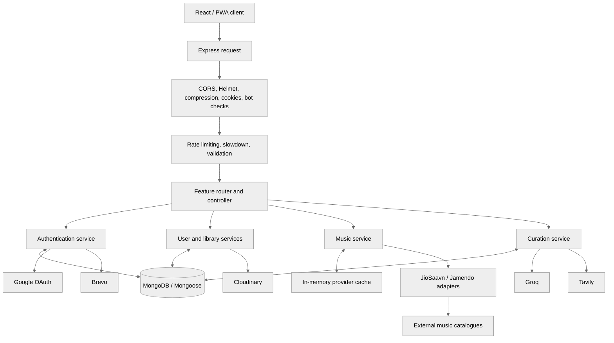
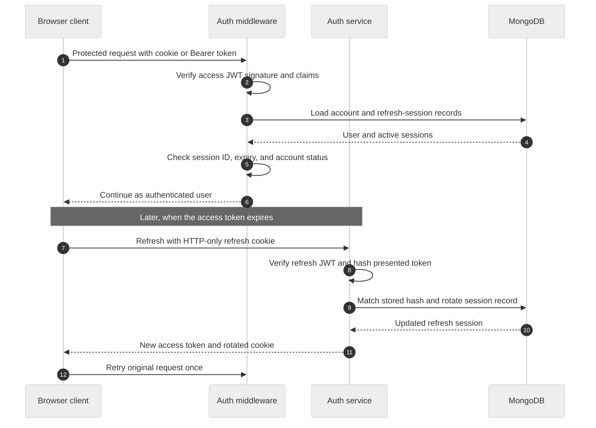
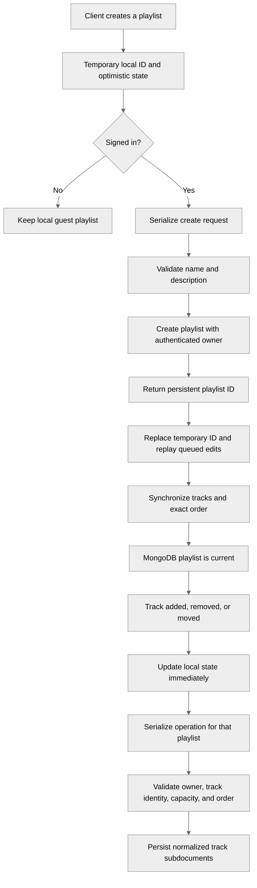
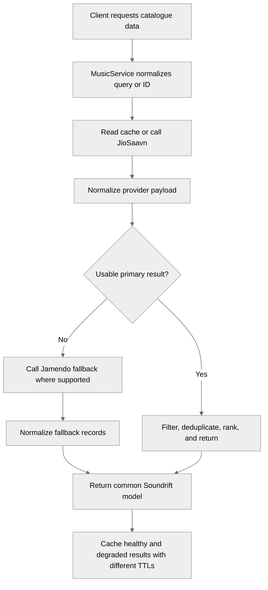
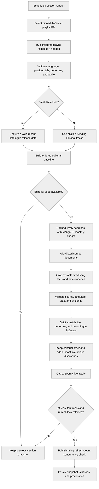

# Soundrift Backend

[](https://nodejs.org/)
[](https://www.typescriptlang.org/)
[](https://expressjs.com/)
[](https://www.mongodb.com/)
[](https://render.com/)

The Soundrift backend is a TypeScript/Express service responsible for identity and sessions, account-backed music libraries, catalogue-provider orchestration, and persisted music discovery. It provides a normalized application interface to the React client while keeping database access, provider credentials, and external service integrations on the server.

---

## Backend responsibilities

| Domain | Responsibilities |
|---|---|
| Authentication | Email OTP verification, password login, Google OAuth, access/refresh sessions, rotation, revocation, and password recovery. |
| User library | Owner-scoped profiles, playlists, favorites, search history, recently played entries, and listening history. |
| Music catalogue | JioSaavn-first search and metadata with Jamendo fallback where supported. |
| Curation | Scheduled AI-assisted and editorial/web discovery, validation, provenance, and MongoDB snapshots. |
| Integrations | Brevo email, Cloudinary avatar storage, Groq completions, and Tavily search. |
| Reliability | Validation, rate limits, caching, bounded retries, refresh locks, and graceful shutdown. |

## Runtime architecture

The backend follows a controller/service/provider separation. Express middleware handles cross-cutting concerns before a controller receives a request. Controllers translate HTTP requests into service calls and consistent responses. Services implement business rules and persistence. Provider adapters isolate the external catalogue formats.



### Request lifecycle

1. The server applies security headers, CORS policy, compression, JSON parsing, cookie parsing, and suspicious-request checks.
2. Feature-specific middleware applies rate limits, progressive slowdown, parameter/body validation, and authentication where required.
3. A controller validates the request context and delegates business work to a service.
4. The service applies domain rules and reads/writes MongoDB or calls an external provider.
5. A normalized response is returned to the client; unhandled errors pass through the centralized error handler.

The service connects to MongoDB and completes required index setup before it starts listening. The curation scheduler starts with the server and is stopped during graceful shutdown.

---

## Authentication and authorization

Authentication is session-aware rather than relying on JWT signature verification alone. An access token is accepted only when its associated user exists, the account is active, and its session identifier still corresponds to a live refresh-session record.

### Email verification and registration

The email registration sequence is:

1. Normalize the supplied email address.
2. Hash the password before saving pending registration details.
3. Generate a cryptographically random six-digit OTP and hash it with bcrypt.
4. Store the OTP hash, expiry, and failed-attempt counter.
5. Send the code using Brevo.
6. Verify the submitted code, enforcing expiry and attempt limits.
7. Mark the address verified.
8. Complete registration and create a server-side refresh-session record.

OTP configuration is intentionally bounded in code: verification and reset codes expire after ten minutes, resend attempts have a cooldown, and failed guesses are capped. The OTP is never stored in plaintext.

### Password login and Google OAuth

Password login normalizes the email, compares the submitted password with the stored bcrypt hash, and checks that the account is active. An unverified email is sent back through the verification flow. On success, the service creates a new session and returns a sanitized user profile.

Google sign-in uses an authorization-code flow with an anti-CSRF state value. The backend places that value in a short-lived HTTP-only cookie, validates the state on callback, exchanges and validates the authorization code, and verifies the Google identity. A verified Google email can be linked to an existing Soundrift account or used to create an account. The resulting session uses the same Soundrift access and refresh mechanism as password login.

### Access token, refresh token, and rotation

- Access and refresh tokens use **different signing secrets**.
- The access token carries the user identity, role, and session identifier.
- The refresh token is stored in an HTTP-only cookie and has a server-side session entry.
- The backend stores SHA-256 hashes of refresh tokens, not raw refresh-token strings.
- Refresh rotates the token hash and tracks the immediately previous hash and rotation time.
- A short grace interval handles requests from parallel tabs that race to refresh the same cookie.
- Logout removes the presented refresh session and clears auth cookies.
- Password changes replace the account's outstanding refresh sessions with a new session for the current device; password recovery invalidates old sessions.

The browser keeps its access-token copy in local storage when Remember Me is enabled and in session storage otherwise. Protected requests send that token as a Bearer credential and include cookies. The authentication middleware accepts the HTTP-only access cookie first, with the Bearer token as a fallback.

### Client refresh coordination

The frontend API client coordinates refresh attempts through one shared in-flight promise. After a protected request receives an unauthorized response, it attempts refresh and retries the original request once. A definitive unauthorized/forbidden refresh response expires the local session. A network failure or server-side 5xx is not treated as proof of revocation, so the client retains its session trace and retries authentication checks.



---

## User data and playlist persistence

The authenticated user's personal library is stored in MongoDB and queried by the user identity attached by authentication middleware. Every playlist update, favorite operation, and history write is scoped to that authenticated user. A user cannot modify another user's private playlist by guessing its database identifier.

### Playlist lifecycle

The frontend uses optimistic local state. A new playlist appears immediately with a temporary client ID. For an authenticated listener, a serialized background operation creates the server record, replaces the temporary ID with the MongoDB ID, and replays changes that occurred before the server ID was known. Guest playlists remain local until the user chooses to export them or otherwise use the local library.

The backend creates a playlist with an owner reference, name, description, visibility flag, timestamps, and an initially empty list of normalized track subdocuments. Visibility defaults to private. Track records preserve their provider and catalogue ID as well as display and playback metadata.



### Validation and concurrency rules

- Maximum 200 playlists per user.
- Maximum 500 tracks per playlist.
- Playlist name is required and limited to 100 characters.
- Description is limited to 500 characters.
- Track IDs are normalized to strings; provider identity is retained.
- Adding a duplicate track is idempotent.
- The add operation includes duplicate and capacity conditions in the database update filter, so concurrent requests cannot both insert the same track or exceed the track cap.
- Reordering must contain every existing track exactly once. Missing IDs, unknown IDs, and duplicate IDs are rejected.
- The client sends only the requested track order IDs for reorder operations, avoiding unnecessarily large request bodies.
- Playlist reads and mutations always include the owner identity.

### Other persisted account data

| Data | Behavior |
|---|---|
| Favorites | Upserted by user and provider track ID. |
| Recently played | Stores the most recent timestamp per user/track and retains a bounded recent collection. |
| Listening history | Records track metadata, play duration, completion state, and playback time, with a bounded history. |
| Search history | Stores normalized queries and retains a short recent list. |
| Profile | Stores account details and profile metadata. |
| Avatar | Uploaded to Cloudinary; replacing an avatar removes the previous Cloudinary asset where possible. |

Account deletion performs a cascade through playlists, favorites, recently played, listening history, and search history, then attempts to remove the avatar asset.

---

## Music provider orchestration

The backend exposes a common catalogue model so the browser does not need provider-specific parsing logic.

### Search path

1. Normalize the query and build a cache key.
2. Request an expanded candidate set from JioSaavn.
3. Remove search noise, normalize fields, deduplicate, and rank the remaining results.
4. Return the best primary results when usable.
5. If the primary provider fails or returns no usable results, query Jamendo and return the fallback results.
6. Give degraded/fallback results a shorter cache lifetime so recovery of the primary catalogue is reflected quickly.

### Metadata and suggestions

Song, album, and playlist metadata lookups prefer JioSaavn, then fall back to Jamendo when the primary lookup fails or does not resolve the ID. Artist album browsing and editorial playlist search are JioSaavn-specific capabilities.

Related-track generation combines three sources where available: provider-native suggestions, tracks by the same artist, and tracks from the same album. Results are scored and deduplicated. If the candidate pool is too small, trending tracks provide a final fallback.

### Normalization details

The normalizer maps provider records into common Song, Album, and Playlist shapes. It cleans HTML-encoded titles, selects suitable images and audio streams, carries provider IDs, and extracts genre metadata. For JioSaavn performer credits, it prefers entries whose role is explicitly singer; this prevents lyricist, composer, or other non-vocal credits from being mistaken for the performer. Playlist parsing isolates malformed entries so one invalid item does not invalidate an otherwise usable playlist. Catalogue release dates are retained for freshness checks.



---

## Curated discovery

Curation is a server-side pipeline. The frontend reads saved section snapshots; it does not generate a new section on every page view. The current system defines ten sections, with different generation strategies for AI-assisted themes and live editorial/web discovery.

### AI-assisted sections

For non-live sections, Groq returns structured song candidates from a section-specific prompt. The candidate parser validates the shape and removes duplicate title/performer pairs. The resolver searches the catalogue, compares both title and artist similarity, rejects weak matches and tracks without playable audio, preserves candidate order, and removes duplicates. It compares sibling sections in the same overlap group to reduce repetitive rows.

### Live sections: Trending and Fresh Releases

Live curation starts from pinned JioSaavn playlist IDs. The IDs are configured intentionally: a playlist name alone is not sufficient evidence that a playlist is the approved editorial source. Ordered fallback IDs allow a later playlist to fill a section when the primary is unavailable or insufficient.

The editorial baseline is filtered by provider, title, performer, playable audio, language, and section rules. Trending can retain eligible tracks without requiring a recent release date. Fresh Releases requires a full, valid, non-future catalogue release date within the configured age window. The default is thirty days.

Web discovery runs only after an editorial baseline has been obtained. Tavily searches recent music coverage for Hindi, Bollywood, Punjabi, and Haryanvi topics. Its results are cached per day and query, restricted to approved HTTPS domains, and counted against a monthly budget stored atomically in MongoDB. If budget or search storage cannot be verified, the system fails closed rather than making an unmetered external request.

Groq extracts candidate song facts from the fetched source documents. Each candidate must be supported by source evidence and a date. Soundrift then uses strict JioSaavn matching across title, performer, and recording version; a similar title alone is not enough. For Fresh Releases, a cited announcement date can fill a missing catalogue date, but cannot override a conflicting older catalogue release date.

The merge retains editorial order, keeps the first twenty editorial positions, adds no more than five unique web-supported tracks, and caps the result at twenty-five. At least ten valid tracks are required before the new section replaces the previous snapshot.



### Scheduling and snapshot safety

The default scheduler timezone is Asia/Kolkata; the default cycle begins at 03:00, with configurable intervals between section jobs. The scheduler checks the most recent due slot rather than requiring the process to be awake during a particular minute, allowing missed refreshes to be backfilled after a restart or deployment.

Refreshes are queued sequentially. A MongoDB-backed lease prevents multiple instances from refreshing the same section simultaneously, and the worker renews its lease while generating. Before replacing a snapshot, the repository checks the previously observed refresh count. If another worker has already written a newer version, the stale writer cannot overwrite it.

The curated-section record stores its title, tracks, generation time, refresh count, model, strategy, validation statistics, web status, and source provenance. If generation fails, the number of resolved songs is insufficient, or lock ownership is lost, the previous saved section remains available.

### Preview and manual refresh

The backend includes dedicated scripts to preview live curation and run a manual refresh. The preview path can inspect the live editorial/web result without replacing the persisted section. The manual refresh path uses the normal curation persistence rules.

---

## Security, caching, and operational behavior

### Security controls

- Helmet security headers and explicit CORS origin allowlisting with credential support.
- HTTP-only cookies with production-aware Secure and SameSite settings.
- Separate signing secrets for access and refresh JWTs.
- Hashed refresh tokens, refresh rotation, session expiry checks, and revocation.
- Bcrypt password and OTP hashing.
- OAuth state validation.
- Zod request validation, JSON body limits, and bounded avatar uploads.
- Route-specific rate limiters and progressive search slowdown.
- Suspicious-request/bot protection and a centralized error handler.
- Backend-only secrets for database, auth, AI, email, and media integrations.

### Caching and reliability

- Provider results are cached to reduce repeated catalogue traffic.
- Empty or fallback search results use a shorter cache lifetime than healthy JioSaavn results.
- Curation snapshots are persisted in MongoDB and briefly cached for repeated reads.
- Tavily searches are keyed by day, query, and approved source configuration; successful cached results expire automatically.
- Each Tavily external attempt reserves a monthly budget in MongoDB before the request is made.
- Provider and model requests use timeouts and bounded retries where appropriate.
- The curation scheduler performs recovery checks for missed slots and retries eligible failures.
- Shutdown stops the scheduler, closes the HTTP server, and disconnects from MongoDB.

---

## Environment configuration

Create a local .env from backend/.env.example. The backend validates required database, token-signing, cookie, and Cloudinary settings at startup. Optional integration settings enable Google OAuth, Brevo email, Jamendo, Groq curation, and Tavily-backed discovery. Keep all credentials in backend-only environment variables and never commit real secrets. The root .env.example contains the frontend's backend URL setting.

See [the backend environment example](.env.example) for the available configuration names and defaults.

---

## Local development

### Prerequisites

- Node.js 18 or later.
- npm.
- MongoDB locally or through a hosted MongoDB service.
- Required backend environment values.

### Install and run

```bash
cd backend
npm install
cp .env.example .env
npm run dev
```

The development server runs on port 5000 by default. Run the frontend separately from the repository root using its development script.

### Build and scripts

```bash
npm run build
npm start
npm test
npm run curate:preview
npm run curate
```

| Script | Purpose |
|---|---|
| npm run dev | Start the TypeScript server with file watching. |
| npm run build | Compile the backend TypeScript application. |
| npm start | Start the compiled production server. |
| npm test | Run the backend Node test suite through tsx. |
| npm run curate:preview | Preview live editorial/web curation without replacing saved sections. |
| npm run curate | Run a manual curation refresh. |

### Render deployment

The backend is deployed independently from the frontend. A typical Render configuration uses:

- **Build command:** `npm --prefix backend install && npm --prefix backend run build`
- **Start command:** `node backend/dist/index.js`

Set the runtime secrets and integration settings in the Render environment dashboard. Ensure the deployed frontend origin is included in the backend CORS allowlist. Cross-origin production cookies require HTTPS and compatible secure/SameSite settings.

---

## Related documentation

- [Main Soundrift project README](../README.md)
- [Environment example](.env.example)
- [MIT License](../LICENSE)
